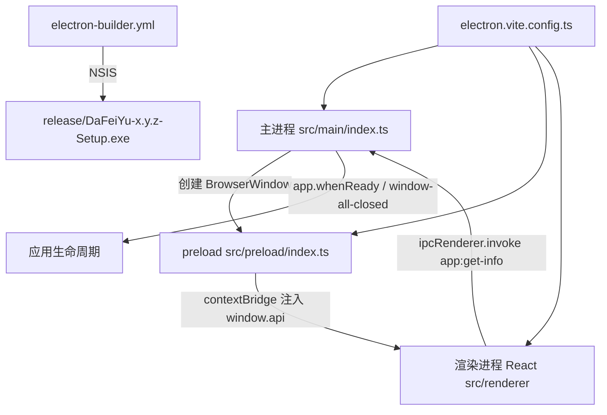

## 用户需求

在空目录 `f:/DaFeiYu` 中从零搭建一个基于 Electron 的桌面应用，使用 React + TypeScript + Vite，能够通过 electron-builder + NSIS 打包成 Windows `.exe` 安装包直接安装使用；同时完成 Git 仓库初始化并关联远程仓库 `https://github.com/wuliaomiemie/DaFeiYu.git`，将代码推送到远程。

## 产品概述

一个名为「大飞鱼」的 Windows 桌面客户端工程骨架。启动后呈现一个完整可运行的应用主界面，同时具备完整的开发调试与 Windows 安装包打包能力，为后续业务功能开发提供稳定基础。

## 核心功能

- 桌面应用启动：可正常打开原生窗口，加载 React 渲染界面，支持开发模式热更新
- 应用主界面：展示应用名称与版本、运行环境信息（Electron / Chromium / Node）、快速上手指引
- 桌面能力桥接：渲染进程通过安全的预加载通道获取版本与应用信息，不直接暴露 Node 能力
- 一键打包：执行打包命令后生成带安装向导的 Windows 安装包，支持选择安装目录、创建桌面与开始菜单快捷方式，安装后可直接运行
- 工程与仓库初始化：完成代码仓库初始化、忽略规则配置、忽略构建产物，并推送至远程仓库主分支

## 技术栈

- 运行时/框架：Electron（最新稳定版）
- 构建工具：electron-vite（主进程 / preload / 渲染进程三端统一构建，内置 HMR）
- 前端：React 19 + TypeScript + Vite
- 样式：Tailwind CSS v4（`@tailwindcss/vite` 插件）
- 打包：electron-builder + NSIS（Windows x64 安装包）
- 语言环境：Node v24.15.0、npm 11.12.1、Git 2.54.0（均已实测可用）

## 实施策略

1. **仓库先初始化**：`git init -b main` → 仅在本仓库 `.git/config` 写入提交身份（`wuliaomiemie` / `wuliaomiemie@users.noreply.github.com`，**不改全局配置**）→ `git remote add origin` → 先落地 `.gitignore`，避免 `node_modules`、`out/`、`release/` 进入版本库。
2. **脚手架一体化**：用 `electron-vite` 统一三端构建，避免手工拼 Vite + tsc + 主进程监听脚本带来的胶水代码与版本漂移。目录遵循 electron-vite 官方约定（`src/main`、`src/preload`、`src/renderer`），产物分别落到 `out/main`、`out/preload`、`out/renderer`，`package.json#main` 指向 `./out/main/index.js`。
3. **安全基线优先**：`contextIsolation: true`、`nodeIntegration: false`、`sandbox: true`；渲染层只通过 `contextBridge` 暴露只读的最小 API；主进程拦截 `window.open` 与外部导航，防止任意跳转。
4. **开发/生产双路径加载**：开发态加载 `process.env['ELECTRON_RENDERER_URL']`，生产态 `loadFile('../renderer/index.html')`；用 `app.isPackaged` 判定，杜绝生产环境误连本地开发服务器。
5. **版本信息零往返**：`process.versions` 在 preload 中读一次并随 `contextBridge` 同步注入，仅应用版本通过一次 `ipcRenderer.invoke('app:get-info')` 获取，避免渲染层多次 IPC 往返与重复渲染。
6. **打包可交付**：`electron-builder.yml` 采用 `nsis` 目标 + `oneClick: false` + `allowToChangeInstallationDirectory: true` + `perMachine: false`（免管理员），`asar: true`，`files` 白名单只含 `out/**` 与 `package.json`，`artifactName` 固定可预期。

### 性能与可靠性

- 渲染层无重型依赖，首屏为静态内容 + 一次 IPC，构建产物小、安装包体积可控。
- `files` 白名单 + `asar` 避免把源码、`node_modules` 冗余打入包内。
- 首包下载 Electron 二进制可能因网络慢而失败：优先使用环境变量 `ELECTRON_MIRROR` / `ELECTRON_BUILDER_BINARIES_MIRROR`（**本次命令内联生效，不写入全局或用户级 npm config**）。
- 网络偶发 `Connection reset`：push 具备重试；若 `ls-remote` 显示远程已有提交，则 `git pull --rebase origin main` 后再推，**不使用 `--force`**。

## 架构设计



## 目录结构

```
DaFeiYu/
├─ .gitignore                      # [NEW] node_modules、out、release、dist、*.log、.DS_Store、.vite 等
├─ .gitattributes                  # [NEW] 统一换行，避免 Windows CRLF 造成全量 diff
├─ .npmrc                          # [NEW] 可选：仅项目级 registry/镜像加速，不影响全局
├─ package.json                    # [NEW] 项目元信息、main 指向 out/main/index.js、dev/build/build:win/typecheck 脚本
├─ electron.vite.config.ts         # [NEW] 三端构建配置：main、preload（externalizeDepsPlugin）、renderer（react + tailwind 插件）
├─ electron-builder.yml            # [NEW] appId、productName、nsis、files 白名单、artifactName、win 目标
├─ tsconfig.json                   # [NEW] 根配置，引用 node/web 两份子配置
├─ tsconfig.node.json              # [NEW] main + preload + 构建脚本的 TS 配置（module: ESNext/CommonJS 按 electron-vite 约定）
├─ tsconfig.web.json               # [NEW] renderer 的 TS 配置（jsx: react-jsx，含 src/preload/*.d.ts 类型）
├─ README.md                       # [NEW] 中文说明：环境要求、npm run dev、npm run build:win、镜像加速、图标替换、常见问题
├─ 第一天.md                        # [KEEP] 用户既有文件，保留不动
├─ build/
│  └─ icon.ico                     # [NEW/可选] 256x256 应用图标；缺失时 electron-builder 回退默认图标，不阻断打包
└─ src/
   ├─ main/
   │  ├─ index.ts                  # [NEW] 创建窗口、安全策略（contextIsolation/sandbox、拦截 window.open 与 will-navigate）、dev/prod 加载分支、IPC 注册、单实例锁
   │  └─ ipc.ts                    # [NEW] 集中注册 ipcMain.handle('app:get-info')，返回 app 名称与版本
   ├─ preload/
   │  ├─ index.ts                  # [NEW] contextBridge.exposeInMainWorld('api', ...)：同步注入 process.versions、异步 getAppInfo
   │  └─ index.d.ts                # [NEW] window.api 的类型声明，供 renderer 复用
   └─ renderer/
      ├─ index.html                # [NEW] 挂载点 + CSP meta（生产安全基线）
      └─ src/
         ├─ main.tsx               # [NEW] React 入口
         ├─ App.tsx                # [NEW] 首页布局装配（5 个区块）
         ├─ vite-env.d.ts          # [NEW] Vite 类型引用
         ├─ assets/main.css        # [NEW] Tailwind 入口 + 玻璃拟态/渐变工具类 + 滚动条与选中样式
         └─ components/
            ├─ AppHeader.tsx       # [NEW] 顶栏：应用名「大飞鱼」、版本徽标、运行状态点
            ├─ HeroPanel.tsx       # [NEW] 主视觉：渐变标题、副标题、两个操作按钮
            ├─ RuntimeInfoCard.tsx # [NEW] 运行环境卡片：Electron / Chromium / Node / 平台架构
            ├─ QuickStartCard.tsx  # [NEW] 命令卡片：dev / build:win 命令 + 一键复制
            └─ StatusBar.tsx       # [NEW] 底部状态栏：就绪提示与打包入口说明
```

## 关键配置结构

`electron-builder.yml` 核心字段（决定安装包行为，需精确落地）：

```
appId: com.wuliaomiemie.dafeiyu
productName: DaFeiYu
directories: { buildResources: build, output: release }
files: [ 'out/**', 'package.json' ]
asar: true
win:
  target: [ { target: nsis, arch: [x64] } ]
  icon: build/icon.ico        # 文件不存在时移除该行以使用默认图标
nsis:
  oneClick: false
  perMachine: false
  allowToChangeInstallationDirectory: true
  createDesktopShortcut: true
  createStartMenuShortcut: true
  shortcutName: 大飞鱼
  artifactName: ${productName}-${version}-Setup.${ext}
```

preload 暴露的最小契约（渲染层依赖，需与 `index.d.ts` 保持一致）：

```ts
export interface AppApi {
  env: { electron: string; chrome: string; node: string; platform: string; arch: string }
  getAppInfo(): Promise<{ name: string; version: string }>
}
```

## 执行注意

- 首次 `npm install` 或打包若卡在 Electron 二进制下载，使用内联环境变量指向镜像（PowerShell：`$env:ELECTRON_MIRROR="https://npmmirror.com/mirrors/electron/"`），**不修改全局配置**。
- 提交身份仅写本仓库：`git config user.name / user.email`（不带 `--global`）。
- 保留 `第一天.md` 与 `.codebuddy` 目录，不做无关重构；构建产物不入库。
- 打包验证以「`release/*.exe` 实际生成」为准，不以命令退出码为准。
- 若远程仓库非空，先 `git fetch origin` 判断，再 `git pull --rebase origin main`，冲突时停止并说明，不强制推送。

## 设计风格

桌面端单页启动台，采用「深空玻璃拟态 + 青紫渐变科技风」。深色背景叠加柔光渐变光斑与细网格纹理，主内容区以半透明玻璃卡片承载，卡片带 1px 高光描边与柔和大投影，营造高级桌面软件的质感。整体克制、信息密度适中，符合桌面端阅读习惯（非移动端放大版）。

## 布局与区块（单页，桌面 1280x800 为基准）

1. **顶栏**：左侧「大飞鱼」字标 + 小号英文副标；右侧版本徽标与带呼吸动效的绿色运行状态点。
2. **主视觉区**：超大渐变标题、一行灰色副标题说明应用定位，下方两个按钮（主按钮实心渐变、次按钮描边玻璃），按钮带 hover 位移与光晕。
3. **运行环境卡片**：四宫格展示 Electron / Chromium / Node / 平台架构，数值用等宽字体，卡片 hover 时描边上浮。
4. **快速上手卡片**：展示 `npm run dev`、`npm run build:win` 命令块，右侧复制按钮，点击后变为「已复制」并回退。
5. **底部状态栏**：左侧圆点 + 「就绪」，右侧一行说明如何产出安装包的提示文案。

## 交互与响应式

- 页面进入时卡片依次淡入上移（stagger 60ms），不超过 500ms，避免拖慢启动感知。
- 窗口最小宽度 1024px 下保持三列布局，窄于此宽度时网格降为单列、间距收窄。
- 所有可交互元素有清晰的 hover / active / focus-visible 态；禁用默认蓝色文本选中高亮，改用主题色。
- 不使用自定义无边框标题栏，保留系统原生边框以保证拖拽、贴边、缩放稳定。